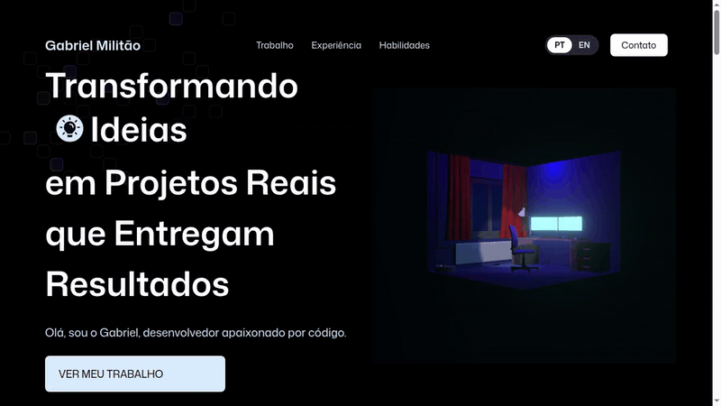

<div align="center">

# Gabriel Militão · Portfolio

Single-page portfolio of a full-stack developer: projects, career and technologies, in **Portuguese and English**, with two 3D scenes, animations that respect `prefers-reduced-motion`, and an accessible contact form.

[Demo](https://gabrielmilitao-dev.vercel.app) · [LinkedIn](https://www.linkedin.com/in/gabrielmilitao98/) · [GitHub](https://github.com/gabrielmilitaosantos)


</div>

## Demo

**https://gabrielmilitao-dev.vercel.app**

[](https://gabrielmilitao-dev.vercel.app)

## About

This portfolio presents my projects, my career and the technologies I work with. It was designed to be quick to read, accessible and bilingual.

The content is verifiable: published projects link to the live site, and the numbers and dates on the page come from my résumé. The visual structure is based on a reference design; the content, copy, languages, animations and components were built by me.

## Highlights

- **Bilingual (PT/EN)** with instant switching. The choice is saved in the browser and the `<html lang>` attribute follows the language.
- **3D scenes** with React Three Fiber: the Hero room (with selective bloom on the monitors) and the Contact desk (lighting and shadows). Drag to rotate, no zoom. On touch screens, the Hero rotates with horizontal drags while vertical drags keep scrolling the page; the Contact scene is mouse-only.
- **Animations with GSAP and ScrollTrigger**, turned off for users who prefer reduced motion (`gsap.matchMedia`, CSS rules, and the counter without counting).
- **Skills** with inline SVG icons (`simple-icons`) that take the brand color on hover, with an automatic fallback when the color has low contrast against the background.
- **Contact form** with translated validation, send states (`idle`, `sending`, `success`, `error`), `aria-live` announcements, and email delivery through EmailJS, with no backend of my own.
- **SEO and sharing:** metadata, Open Graph, `canonical` and structured data (`schema.org/Person`).
- **Responsive**, from phones to ultrawide monitors, built on grid layouts.

## Tech stack

| Layer     | Technologies                                                                    | Used for                                                            |
| --------- | ------------------------------------------------------------------------------- | ------------------------------------------------------------------- |
| Core      | React 19, TypeScript, Vite                                                      | SPA with strict typing and fast builds                              |
| Styling   | Tailwind CSS v4                                                                 | Tokens in `@theme`; components with `@apply` in `@layer components` |
| Animation | GSAP, ScrollTrigger, `@gsap/react`                                              | Scroll entrances and the animated timeline                          |
| 3D        | three, `@react-three/fiber`, `@react-three/drei`, `@react-three/postprocessing` | Hero and Contact scenes                                             |
| Icons     | simple-icons                                                                    | Technology logos as inline SVG                                      |
| Numbers   | react-countup                                                                   | Hero counters                                                       |
| Email     | `@emailjs/browser`                                                              | Contact form delivery                                               |
| Quality   | ESLint (typescript-eslint), Prettier, React Compiler                            | Linting, formatting and automatic memoization                       |
| Hosting   | Vercel                                                                          | Continuous deployment                                               |

## Project structure

Overview of the main folders:

```text
public/
  images/                 images, icons, textures and og-image.jpg
  models/                 optimized 3D models (.glb)
  favicon.svg
src/
  components/             Button, TitleHeader, GlowCard, SkillCard, TechMarquee,
                          NavBar, LanguageSwitcher, Footer, ...
    HeroModels/           Hero 3D scene (room, lights)
    ContactModels/        Contact 3D scene (desk and computer)
  sections/               Hero, Showcase, FeatureCards, Experience, Skills, Contact
  constants/index.ts      structural lists (projects, experience, skills), already as {pt, en}
  locales/                en.ts and pt.ts (loose texts; pt is checked against en)
  contexts/               LanguageContext and LanguageProvider
  hooks/                  useTranslation
  utils/                  brandColor (contrast fallback for brand colors)
  index.css               theme tokens and components
```

## Getting started

**Prerequisites:** Node.js 20.19+ (or 22.12+) and npm.

```bash
# 1. clone the repository and enter the project folder
git clone https://github.com/gabrielmilitaosantos/3D-Portfolio.git
cd 3D-Portfolio

# 2. install the dependencies
npm install

# 3. create the environment file and fill in the values (see the table below)
cp .env.example .env        # on Windows (cmd): copy .env.example .env

# 4. start the development server
npm run dev
```

The site opens at `http://localhost:5173`. Without the EmailJS variables the site works normally, but the contact form shows the error message on submit.

### Environment variables

| Variable                   | Description                                                                                                                                                                                    |
| -------------------------- | ---------------------------------------------------------------------------------------------------------------------------------------------------------------------------------------------- |
| `VITE_EMAILJS_SERVICE_ID`  | Email service ID (EmailJS → _Email Services_)                                                                                                                                                  |
| `VITE_EMAILJS_TEMPLATE_ID` | Template ID (EmailJS → _Email Templates_)                                                                                                                                                      |
| `VITE_EMAILJS_PUBLIC_KEY`  | Public key (EmailJS → _Account_)                                                                                                                                                               |
| `VITE_SITE_URL`            | Public URL of the site, **without a trailing slash** (e.g. `https://my-site.com`). Used by the `canonical` and Open Graph tags at build time. In development it can be `http://localhost:5173` |

> Every `VITE_*` value is embedded in the bundle and is therefore **public**. Never put private keys in these variables.

**EmailJS template:** the code sends the keys `name`, `email` and `message`. In the template, use `{{name}}`, `{{email}}` and `{{message}}`, with `Reply To` set to `{{email}}` so the _Reply_ button goes straight to the sender.

### Scripts

| Command           | What it does                                       |
| ----------------- | -------------------------------------------------- |
| `npm run dev`     | Development server with hot reload                 |
| `npm run build`   | Production build into `dist/`                      |
| `npm run preview` | Serves the build locally (`http://localhost:4173`) |
| `npm run lint`    | Runs ESLint                                        |

## Design decisions

- **Internationalization without a library.** A React context exposes the dictionary of the active language. Structural lists (cards, projects, experience) live in `constants` as `{ pt, en }`; loose texts live in `locales`. The Portuguese dictionary uses `satisfies typeof en`, so a missing key becomes a compile error.
- **Reduced motion, end to end.** GSAP animations run inside `gsap.matchMedia`; CSS turns off the word slider, the button arrow and smooth scrolling; the counter shows the final value right away; the technology marquee becomes a static list.
- **Accessible brand icons.** `brandColor` computes the WCAG contrast between the brand color and the background and swaps in a light color when it drops below 3:1 (near-black logos such as Next.js and Express).
- **3D that does not get in the way of the page.** Both scenes are code-split with `React.lazy`, so the initial JavaScript stays small (about 140 KB gzipped) and the three.js chunk loads on demand. They render only when something changes (`frameloop="demand"`). Rotation has no zoom; on touch, `touch-action: pan-y` lets vertical drags scroll the page and uses horizontal drags to rotate the Hero model.
- **CSS without cascade exceptions.** Everything lives inside `@layer`, except `:root` and the `@keyframes`, so Tailwind utilities can always override the components.
- **Email without a server.** EmailJS covers a portfolio form with no backend. The code limits sends per browser (a 429 response) and logs errors to the console to make diagnosis easier.

## Accessibility

- Contrast: the main text color pairs I measured range from 4.8:1 to 17.4:1.
- The hero headline is a single `<h1>`; the rotating word slider is hidden from assistive technology and its words are announced once, as text.
- Form with a `label` tied to every field, `autocomplete`, and translated validation messages.
- Send result announced through an `aria-live` region.
- Decorative images use `alt=""` or `aria-hidden`; icon-only links have an accessible name.
- Keyboard navigation and anchors offset for the fixed navbar (`scroll-padding-top`).
- Respect for `prefers-reduced-motion` (see above).

## Deployment

The site is published on **Vercel**.

`vercel.json` adds security headers and long-lived caching for hashed assets.

1. Import the repository into Vercel (_Vite_ preset).
2. Under _Project Settings → Environment Variables_, add the four variables from the table above, for both **Production** and **Preview**. Save them as **Config**, not Secret: Vercel rejects `VITE_*` secrets, because these values are public by design.
3. Deploy. Since `VITE_*` values are baked into the build, **changing a variable requires a new deploy**.
4. Check the published page's source: the `og:image` and `canonical` tags must show the full URL, without `%VITE_SITE_URL%`.

## Contact

Gabriel Militão · [LinkedIn](https://www.linkedin.com/in/gabrielmilitao98/) · [GitHub](https://github.com/gabrielmilitaosantos)
